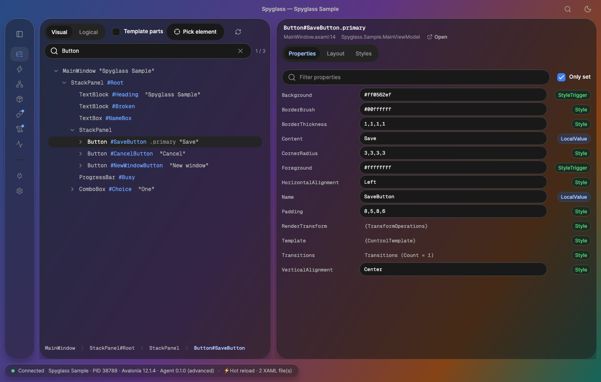
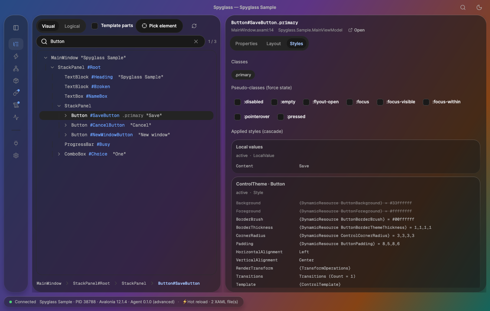
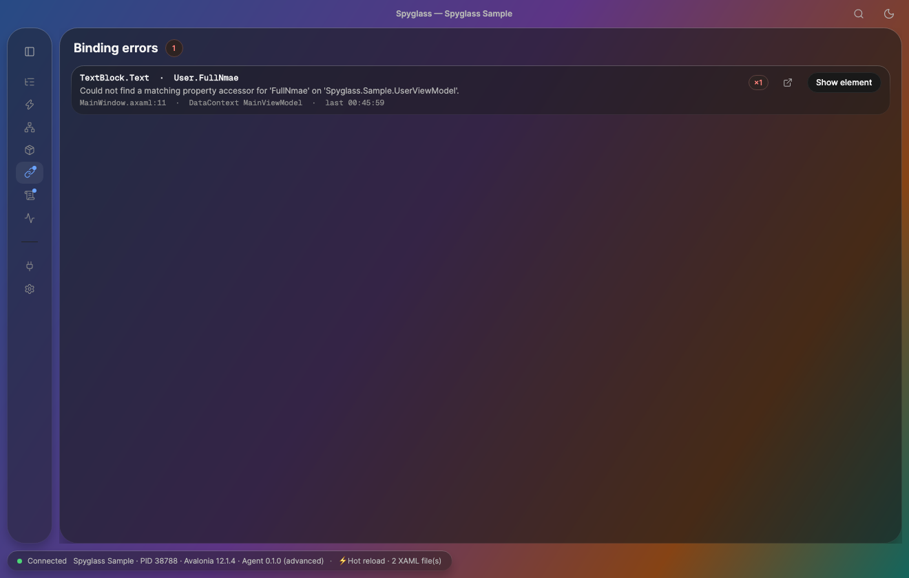
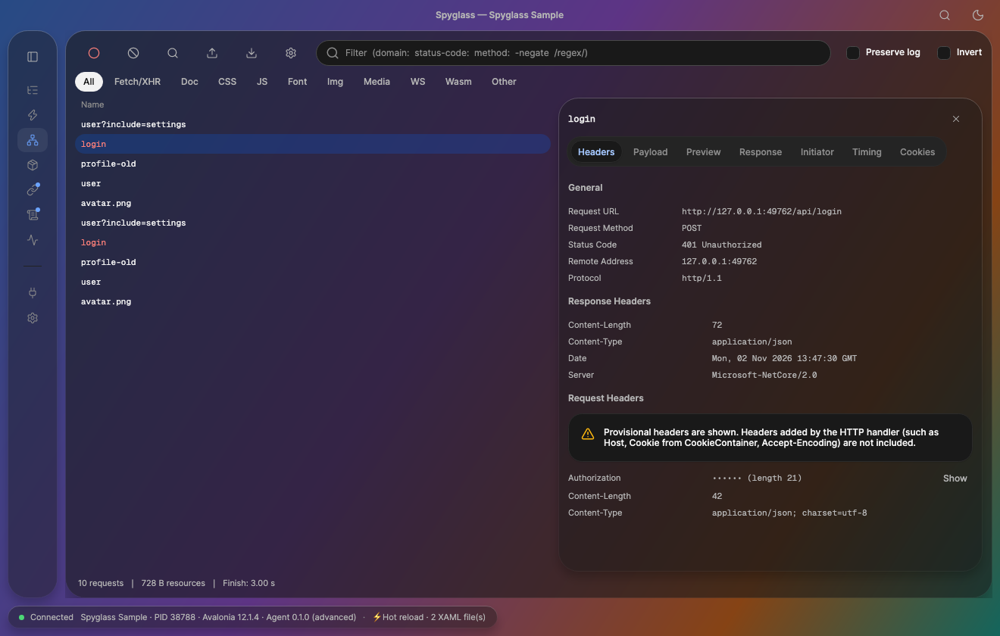
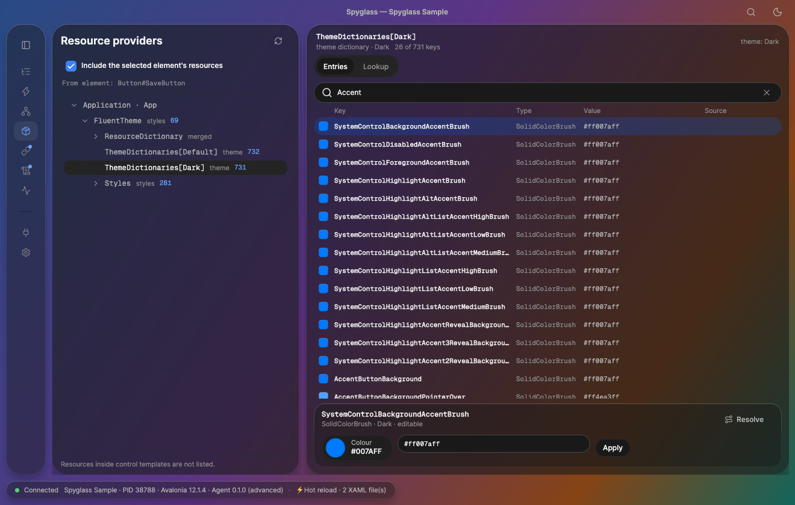
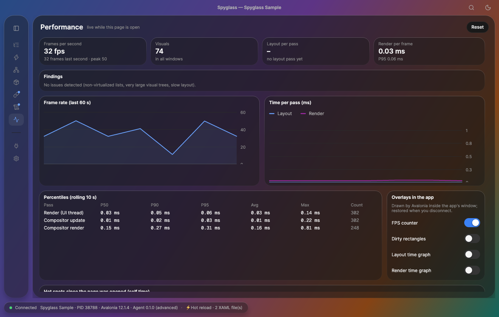

**English** | [简体中文](README.zh-CN.md)

# Spyglass

Open-source, out-of-process debugging tool for Avalonia UI apps (like browser DevTools), with a free MCP server for AI coding agents. Product design lives in [`design/`](design/README.md).



## Features

| | |
|---|---|
| **Elements**: visual/logical tree, search, pick-an-element, live property editing, XAML source locations | **Styles**: the applied cascade, overridden values struck through, force `:pointerover`/`:pressed` and other pseudo-classes |
|  |  |
| **Binding errors**: the failing path, the message, the XAML line and the DataContext, with a jump to the element | **Network**: Chrome-style request list with headers, payload, timing and cookies; HAR import/export |
|  |  |
| **Resources**: browse theme dictionaries and styles, look up keys, edit colours live | **Performance**: FPS, layout/render percentiles, findings and in-app overlays |
|  |  |

The screenshots are of the bundled `samples/Spyglass.Sample` app (it has a deliberate binding typo and some HTTP traffic).

## Getting started: attach Spyglass to your app

Spyglass runs as its own window and your app connects to it over a local WebSocket (`127.0.0.1:29500`). Pick the case that matches your app.

**1. Your own Avalonia 12 app (recommended)**

1. Install the client once: `dotnet tool install -g TKCode.Spyglass` (gives the `spyglass` command; see [Install as a tool](#install-as-a-tool)).
2. Reference the agent from the app project (Debug only) and enable it:
   ```xml
   <PackageReference Include="TKCode.Spyglass.Agent" Version="..." Condition="'$(Configuration)' == 'Debug'" />
   ```
   ```csharp
   using Avalonia;
   using Spyglass.Agent;   // UseSpyglass()

   AppBuilder.Configure<App>().UsePlatformDetect()
   #if DEBUG
       .UseSpyglass()
   #endif
   ;
   ```
3. Run the app and press **Ctrl+Shift+I** (macOS **Cmd+Option+I**). Spyglass opens (it is started if needed) and the app appears under the connection list. Use **Ctrl+Shift+C** to pick an element.

**2. An Avalonia 11.2+ app**: use the `TKCode.Spyglass.Agent.Avalonia11` package instead (same `UseSpyglass()` call, no XAML source locations).

**3. No code changes**: start the app through the startup hook, `spyglass run dotnet MyApp.dll` (or `spyglass run ./MyApp`). Works with Avalonia 11.2+ and 12.

**4. An app on another machine, a VM or a phone**

1. On the machine running Spyglass: **Settings › Connection**, turn on *Other devices*, and note the 6-digit pairing code. Only the agent endpoint is exposed; MCP stays local, and the connection is not encrypted, so use trusted networks only.
2. On the app side, point the agent at that machine and give it the code, either with environment variables
   ```bash
   SPYGLASS_HOST=192.168.1.20 SPYGLASS_PORT=29500 SPYGLASS_PAIRING_CODE=123456 ./MyApp
   ```
   or in code:
   ```csharp
   .UseSpyglass(o => { o.Host = "192.168.1.20"; o.PairingCode = "123456"; })
   ```
   (From an Android emulator the host machine is usually `10.0.2.2`.) Open the firewall for the port if the connection is refused.

**5. Let your AI coding agent use it**: `claude mcp add spyglass -- spyglass mcp` (see [Install as a tool](#install-as-a-tool)).

**Troubleshooting**
- *Nothing shows up in the connection list*: the app must run a Debug build with `.UseSpyglass()` (or `spyglass run`), and Spyglass must listen on the same port (`SPYGLASS_PORT` / Settings › Port).
- *Hotkey does nothing*: another handler may use the same keys; change them with `o.OpenGesture` / `o.InspectGesture`.
- *Remote app is rejected*: *Other devices* is off, or the pairing code is wrong or has changed.

## Projects

| Path | What |
|---|---|
| `src/Spyglass.Protocol` | Wire contract (JSON-RPC 2.0 over WebSocket), shared by agent and client |
| `src/Spyglass.Agent` | In-app agent: `AppBuilder.UseSpyglass()` (public Avalonia APIs only) |
| `src/Spyglass.StartupHook` (`spyglass run <command>`) | Attach without code changes: `DOTNET_STARTUP_HOOKS=…/Spyglass.StartupHook.dll dotnet MyApp.dll` (Avalonia 11.2+ and 12; `SPYGLASS_ATTACH=advanced` for the Advanced agent on 12.1.4) |
| `src/Spyglass.Agent.Avalonia11` | The same agent built for Avalonia 11.2+ apps (`TKCode.Spyglass.Agent.Avalonia11` package; same namespace, no XAML source locations) |
| `src/Spyglass.Agent.HotReload` | XAML hot reload in the app (`TKCode.Spyglass.HotReload` package, Debug only), with `src/Spyglass.HotReload.Generators` |
| `src/Spyglass.Agent.Advanced` | Advanced agent features on Avalonia private APIs (`UseSpyglassAdvanced()`, pinned to Avalonia 12.1.4) |
| `src/Spyglass.App.Core` | Hub that agents connect to (`ws://127.0.0.1:29500/agent`) and the typed session API |
| `src/Spyglass.Mcp` | MCP server mounted at `http://127.0.0.1:29500/mcp` |
| `src/Spyglass.App` | The Spyglass desktop client (Avalonia 12.1.4 + TKCode.Arc) |
| `ide/vscode` | VS Code extension: XAML hot reload from unsaved buffers, diagnostics, status |
| `ide/rider` | Rider plugin (Kotlin), same features ([README](ide/rider/README.md)) |
| `ide/vs` | Visual Studio 2022 17.14+ extension (VisualStudio.Extensibility), same features ([README](ide/vs/README.md)) |
| `samples/Spyglass.Sample` | A small app to debug |
| `tests/` | Protocol tests and end-to-end tests (headless app + hub + MCP client) |
| `spike/` | Throwaway prototypes behind the design decisions |

## Try it

```bash
dotnet run --project src/Spyglass.App            # 1. start Spyglass (listens on 127.0.0.1:29500)
dotnet run --project samples/Spyglass.Sample     # 2. start the sample app; it connects automatically
claude mcp add --transport http spyglass http://127.0.0.1:29500/mcp   # 3. optional: give your coding agent access
```

## Install as a tool

```bash
dotnet tool install -g TKCode.Spyglass        # then: `spyglass` (GUI) and `spyglass mcp` (headless MCP server)
```

NuGet packages are published as `TKCode.Spyglass.*` (the tool is `TKCode.Spyglass`; the command stays `spyglass`).
The agent package is `TKCode.Spyglass.Agent` (`TKCode.Spyglass.Agent.Avalonia11` for Avalonia 11.2+ apps).

`spyglass mcp` is for editors that launch an MCP server process (stdio), CI and remote machines. If a Spyglass is already
running on the port it forwards to it, so your coding agent and the GUI share one session:

```bash
claude mcp add spyglass -- spyglass mcp          # stdio; add --read-only / --no-input to restrict what the agent can do
spyglass mcp --http --port 29500                 # or serve MCP over HTTP (CI / remote)
```

## Debug your own app

```csharp
using Avalonia;
using Spyglass.Agent;

AppBuilder.Configure<App>()
    .UsePlatformDetect()
#if DEBUG
    .UseSpyglass()
#endif
    ;
```

In the running app, **Ctrl+Shift+I** (macOS **Cmd+Option+I**) brings Spyglass to the front, starting it if needed;
**Ctrl+Shift+C** (macOS **Cmd+Shift+C**) picks an element, like Chrome DevTools. To let the app start Spyglass, put the
`spyglass` command on PATH or set `SPYGLASS_CLIENT` (e.g. to `src/Spyglass.App/bin/Debug/net10.0/Spyglass`).

```csharp
using Avalonia.Input;   // KeyGesture, Key
using Spyglass.Agent;

.UseSpyglass(o =>
{
    o.OpenGesture = new KeyGesture(Key.F12);   // or null to disable
    o.ClientPath = "/path/to/Spyglass";
})
```

## Hot reload (XAML)

Add the hot reload package to the app (Debug builds only; nothing to call in code):

```xml
<PackageReference Include="TKCode.Spyglass.HotReload" Version="..." Condition="'$(Configuration)' == 'Debug'" />
```

Run the app with `.UseSpyglass()` while Spyglass (or the headless `spyglass serve`) is running. Saving a `.axaml` file
in any editor updates the running app in place: the view keeps its DataContext, typed text, selection, scroll position
and focus, and new instances (list items, windows opened later) use the new XAML too. A XAML mistake does not touch the
app; the error with its line and column is shown in the Spyglass status bar, printed by `spyglass serve`, and returned by
the MCP tool `hot_reload_status`.

```bash
dotnet run --project src/Spyglass.App -- serve   # hub without the GUI: prints connections and every reload
```

**VS Code**: the extension in [`ide/vscode`](ide/vscode/README.md) sends *unsaved* edits as you type (300 ms after you
stop), shows XAML errors as squiggles, and starts `spyglass serve` when nothing is running. Not on the Marketplace yet:
`cd ide/vscode && npm install && npm run package`, then install the `.vsix`. **Rider** ([`ide/rider`](ide/rider/README.md)) and
**Visual Studio** ([`ide/vs`](ide/vs/README.md)) have the same features; build them from source for now.

**Styles, resource dictionaries and App.axaml** reload too: a changed `Styles`/`ResourceDictionary` file replaces what
its `StyleInclude`/`ResourceInclude` loaded, and documents that merge it (`MergeResourceInclude`) or read its keys as
`{StaticResource}` are re-applied, so both dynamic and static uses update.

**C# and `dotnet watch`**: run the app with `dotnet watch` (or Visual Studio / C# Dev Kit hot reload) and C# changes apply
too; Spyglass re-reads the bindings of view models whose code changed. Saved `.axaml` files also travel inside those
deltas, so XAML hot reload works under `dotnet watch` even without Spyglass running (`spyglass serve --no-watch` avoids
applying a save twice). In Debug builds the package generates each view's `InitializeComponent` and turns `x:Name`
fields into properties, so adding an `x:Name` no longer breaks new instances under `dotnet watch`; opt out with
`<SpyglassHotReloadInitializeComponent>false</SpyglassHotReloadInitializeComponent>`.

In this repo the sample references it with a project reference (`samples/Spyglass.Sample/Spyglass.Sample.csproj`).
Design and roadmap (IDE extensions with unsaved-buffer reload, C# changes): [`design/hot-reload/`](design/hot-reload/README.md).

## Settings

Theme, accent colour, animations, port, Network capture options and the editor used by "Open in editor" are in the
**Settings** page. They apply immediately and are stored in `~/.spyglass/settings.json`
(`SPYGLASS_HOME` moves the whole folder, `SPYGLASS_SETTINGS` just this file; settings from the old OS app-data folder are copied over once).

- **Language**: English, 简体中文 or 繁體中文 (Settings › Appearance; changes live).
- **Command palette**: Cmd/Ctrl+I (changeable in Settings › Keyboard shortcuts; or the search button in the title bar) finds pages, actions (pick an element, record network…), settings and named elements; Cmd/Ctrl+1…9 jump to a page.
- **Keyboard shortcuts**: the Network page keys can be changed in Settings (click a field, press the keys).
- **Other devices** (off by default): Settings › Connection lets phones or other machines connect with a 6-digit pairing code.
  Only the agent endpoint is reachable from the network (MCP stays local); the connection is not encrypted, use trusted networks only.

## Test

```bash
dotnet test --project tests/Spyglass.Protocol.Tests
dotnet test --project tests/Spyglass.IntegrationTests
```
