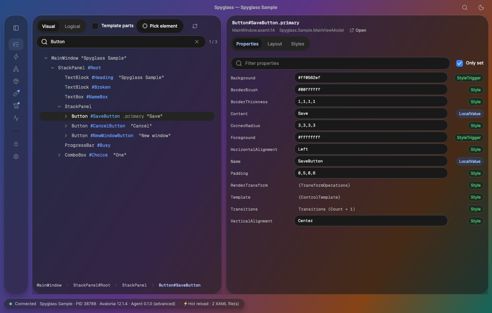
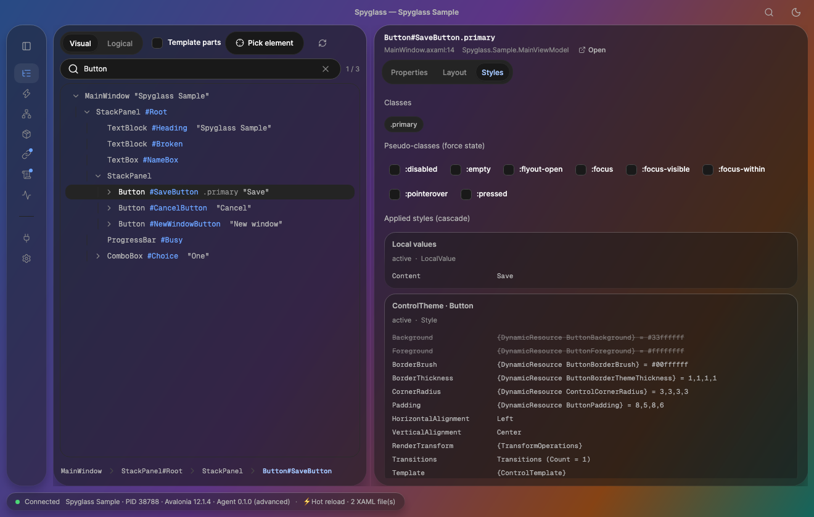
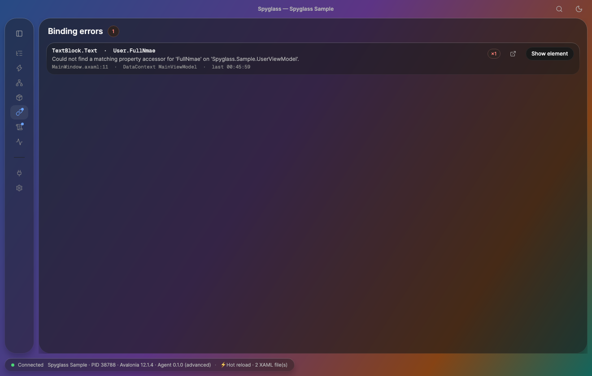
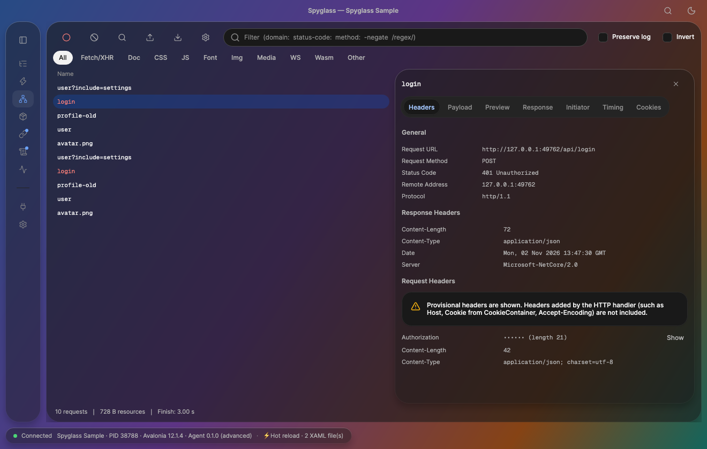
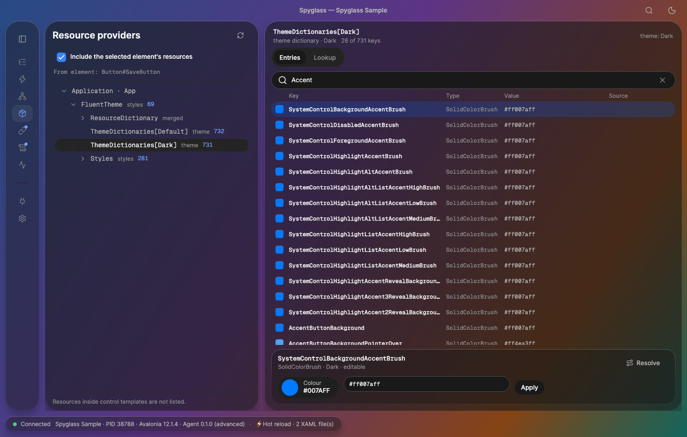
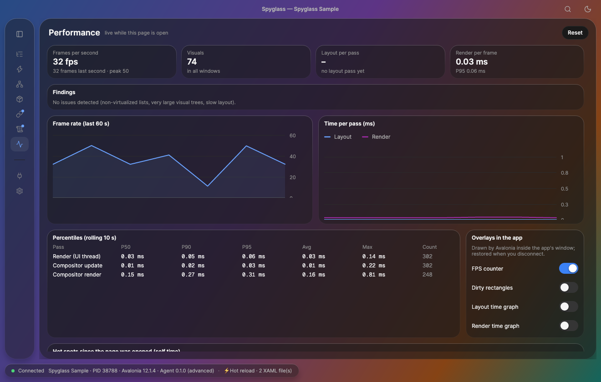

[English](README.md) | **简体中文**

# Spyglass

开源的 Avalonia UI 应用进程外调试工具（类似浏览器 DevTools），并提供免费的 MCP 服务器供 AI 编程代理使用。产品设计见 [`design/`](design/README.md)。



## 功能

| | |
|---|---|
| **元素**：可视/逻辑树、搜索、拾取元素、实时编辑属性、XAML 源码位置 | **样式**：已应用的样式级联，被覆盖的值以删除线标出，可强制 `:pointerover`/`:pressed` 等伪类 |
|  |  |
| **绑定错误**：出错的路径、消息、XAML 行号和 DataContext，可跳转到对应元素 | **网络**：Chrome 风格的请求列表，含请求头、负载、时间线和 Cookie；支持 HAR 导入/导出 |
|  |  |
| **资源**：浏览主题字典和样式、查找键、实时编辑颜色 | **性能**：FPS、布局/渲染百分位、问题提示和应用内叠加层 |
|  |  |

截图取自内置的 `samples/Spyglass.Sample` 示例应用（其中故意写了一个绑定拼写错误，并会产生一些 HTTP 请求）。

## 快速上手：把 Spyglass 接入你的应用

Spyglass 是一个独立窗口，你的应用通过本机 WebSocket（`127.0.0.1:29500`）连接到它。请按应用类型选择：

**1. 你自己的 Avalonia 12 应用（推荐）**

1. 安装一次客户端：`dotnet tool install -g TKCode.Spyglass`（提供 `spyglass` 命令，见[作为全局工具安装](#作为全局工具安装)）。
2. 在应用项目中引用 Agent（仅 Debug）并启用：
   ```xml
   <PackageReference Include="TKCode.Spyglass.Agent" Version="..." Condition="'$(Configuration)' == 'Debug'" />
   ```
   ```csharp
   using Avalonia;
   using Spyglass.Agent;   // UseSpyglass()

   AppBuilder.Configure<App>().UsePlatformDetect()
   #if DEBUG
       .UseSpyglass()
   #endif
   ;
   ```
3. 运行应用，按 **Ctrl+Shift+I**（macOS 为 **Cmd+Option+I**）。Spyglass 会打开（未运行时自动启动），应用会出现在连接列表中。按 **Ctrl+Shift+C** 可拾取元素。

**2. Avalonia 11.2+ 应用**：改用 `TKCode.Spyglass.Agent.Avalonia11` 包（调用同样是 `UseSpyglass()`，但没有 XAML 源码位置）。

**3. 不改代码**：通过启动钩子启动应用：`spyglass run dotnet MyApp.dll`（或 `spyglass run ./MyApp`）。支持 Avalonia 11.2+ 和 12。

**4. 另一台机器、虚拟机或手机上的应用**

1. 在运行 Spyglass 的机器上：**设置 › 连接**，打开*其他设备*，记下 6 位配对码。只有 Agent 端点对网络开放，MCP 仍仅限本机；连接未加密，请只在可信网络中使用。
2. 在应用端让 Agent 指向该机器并提供配对码，可用环境变量：
   ```bash
   SPYGLASS_HOST=192.168.1.20 SPYGLASS_PORT=29500 SPYGLASS_PAIRING_CODE=123456 ./MyApp
   ```
   或在代码中：
   ```csharp
   .UseSpyglass(o => { o.Host = "192.168.1.20"; o.PairingCode = "123456"; })
   ```
   （Android 模拟器访问宿主机通常用 `10.0.2.2`。）如果连接被拒绝，请在防火墙放行该端口。

**5. 让 AI 编程代理使用**：`claude mcp add spyglass -- spyglass mcp`（见[作为全局工具安装](#作为全局工具安装)）。

**常见问题**
- *连接列表里没有应用*：应用必须是 Debug 构建并调用了 `.UseSpyglass()`（或用 `spyglass run` 启动），且 Spyglass 监听的端口要一致（`SPYGLASS_PORT` / 设置中的端口）。
- *快捷键没反应*：可能被其他处理程序占用，可通过 `o.OpenGesture` / `o.InspectGesture` 修改。
- *远程应用被拒绝*：*其他设备*未开启，或配对码错误/已变更。

## 项目结构

| 路径 | 说明 |
|---|---|
| `src/Spyglass.Protocol` | 通信协议（基于 WebSocket 的 JSON-RPC 2.0），Agent 与客户端共用 |
| `src/Spyglass.Agent` | 应用内 Agent：`AppBuilder.UseSpyglass()`（仅使用 Avalonia 公开 API） |
| `src/Spyglass.StartupHook`（`spyglass run <command>`） | 无需改代码即可附加：`DOTNET_STARTUP_HOOKS=…/Spyglass.StartupHook.dll dotnet MyApp.dll`（Avalonia 11.2+ 和 12；设置 `SPYGLASS_ATTACH=advanced` 可在 12.1.4 上使用 Advanced Agent） |
| `src/Spyglass.Agent.Avalonia11` | 面向 Avalonia 11.2+ 应用的同一 Agent（`Spyglass.Agent.Avalonia11` 包；命名空间相同，无 XAML 源码位置） |
| `src/Spyglass.Agent.HotReload` | 应用内 XAML 热重载（`Spyglass.HotReload` 包，仅 Debug），配套 `src/Spyglass.HotReload.Generators` |
| `src/Spyglass.Agent.Advanced` | 基于 Avalonia 私有 API 的高级 Agent 功能（`UseSpyglassAdvanced()`，固定 Avalonia 12.1.4） |
| `src/Spyglass.App.Core` | Agent 连接的 Hub（`ws://127.0.0.1:29500/agent`）和强类型会话 API |
| `src/Spyglass.Mcp` | 挂载在 `http://127.0.0.1:29500/mcp` 的 MCP 服务器 |
| `src/Spyglass.App` | Spyglass 桌面客户端（Avalonia 12.1.4 + TKCode.Arc） |
| `ide/vscode` | VS Code 扩展：从未保存的缓冲区热重载 XAML、诊断、状态 |
| `ide/rider` | Rider 插件（Kotlin），功能相同（[README](ide/rider/README.md)） |
| `ide/vs` | Visual Studio 2022 17.14+ 扩展（VisualStudio.Extensibility），功能相同（[README](ide/vs/README.md)） |
| `samples/Spyglass.Sample` | 用来调试的小型示例应用 |
| `tests/` | 协议测试和端到端测试（无头应用 + Hub + MCP 客户端） |
| `spike/` | 支撑设计决策的一次性原型 |

## 快速体验

```bash
dotnet run --project src/Spyglass.App            # 1. 启动 Spyglass（监听 127.0.0.1:29500）
dotnet run --project samples/Spyglass.Sample     # 2. 启动示例应用，它会自动连接
claude mcp add --transport http spyglass http://127.0.0.1:29500/mcp   # 3. 可选：让你的编程代理使用它
```

## 作为全局工具安装

```bash
dotnet tool install -g Spyglass        # 然后：`spyglass`（GUI）和 `spyglass mcp`（无界面 MCP 服务器）
```

`spyglass mcp` 适用于由编辑器启动 MCP 服务器进程（stdio）、CI 和远程机器的场景。如果该端口上已有 Spyglass 在运行，它会转发过去，
这样编程代理和 GUI 就共用同一个会话：

```bash
claude mcp add spyglass -- spyglass mcp          # stdio；加 --read-only / --no-input 可限制代理的权限
spyglass mcp --http --port 29500                 # 或通过 HTTP 提供 MCP（CI / 远程）
```

## 调试你自己的应用

```csharp
using Avalonia;
using Spyglass.Agent;

AppBuilder.Configure<App>()
    .UsePlatformDetect()
#if DEBUG
    .UseSpyglass()
#endif
    ;
```

在运行中的应用里，**Ctrl+Shift+I**（macOS 为 **Cmd+Option+I**）会把 Spyglass 切到前台，必要时先启动它；
**Ctrl+Shift+C**（macOS 为 **Cmd+Shift+C**）像 Chrome DevTools 一样拾取元素。若要让应用自行启动 Spyglass，请把
`spyglass` 命令加入 PATH，或设置 `SPYGLASS_CLIENT`（例如 `src/Spyglass.App/bin/Debug/net10.0/Spyglass`）。

```csharp
using Avalonia.Input;   // KeyGesture, Key
using Spyglass.Agent;

.UseSpyglass(o =>
{
    o.OpenGesture = new KeyGesture(Key.F12);   // 设为 null 可禁用
    o.ClientPath = "/path/to/Spyglass";
})
```

## 热重载（XAML）

在应用中添加热重载包（仅 Debug 构建；代码中无需任何调用）：

```xml
<PackageReference Include="Spyglass.HotReload" Version="..." Condition="'$(Configuration)' == 'Debug'" />
```

在 Spyglass（或无界面的 `spyglass serve`）运行时，用 `.UseSpyglass()` 启动应用。在任意编辑器中保存 `.axaml` 文件，
运行中的应用就会原地更新：视图保留其 DataContext、已输入的文本、选中项、滚动位置和焦点，之后新建的实例（列表项、稍后打开的窗口）
也会使用新的 XAML。XAML 写错不会影响应用；带行列号的错误会显示在 Spyglass 状态栏、由 `spyglass serve` 打印，并通过 MCP 工具
`hot_reload_status` 返回。

```bash
dotnet run --project src/Spyglass.App -- serve   # 不带 GUI 的 Hub：打印连接和每次重载
```

**VS Code**：[`ide/vscode`](ide/vscode/README.md) 中的扩展会在你输入时发送*未保存*的修改（停止输入 300 ms 后），
用波浪线显示 XAML 错误，并在没有运行实例时启动 `spyglass serve`。尚未上架 Marketplace：
`cd ide/vscode && npm install && npm run package`，然后安装生成的 `.vsix`。**Rider**（[`ide/rider`](ide/rider/README.md)）和
**Visual Studio**（[`ide/vs`](ide/vs/README.md)）功能相同；目前请从源码构建。

**样式、资源字典和 App.axaml** 同样会重载：修改后的 `Styles`/`ResourceDictionary` 文件会替换 `StyleInclude`/`ResourceInclude`
加载的内容，合并它的文档（`MergeResourceInclude`）或以 `{StaticResource}` 读取其键的文档会被重新应用，因此动态和静态引用都会更新。

**C# 与 `dotnet watch`**：用 `dotnet watch`（或 Visual Studio / C# Dev Kit 热重载）运行应用，C# 的修改也会生效；
Spyglass 会重新读取代码已变更的视图模型的绑定。保存的 `.axaml` 文件也会随这些增量一起传递，因此即使没有运行 Spyglass，
`dotnet watch` 下 XAML 热重载也能工作（`spyglass serve --no-watch` 可避免同一次保存被应用两次）。在 Debug 构建中，该包会生成每个视图的
`InitializeComponent`，并把 `x:Name` 字段转换为属性，因此在 `dotnet watch` 下新增 `x:Name` 不再导致新实例出错；
可通过 `<SpyglassHotReloadInitializeComponent>false</SpyglassHotReloadInitializeComponent>` 关闭。

本仓库中的示例以项目引用的方式使用它（`samples/Spyglass.Sample/Spyglass.Sample.csproj`）。
设计与路线图（支持未保存缓冲区热重载的 IDE 扩展、C# 变更）：[`design/hot-reload/`](design/hot-reload/README.md)。

## 设置

主题、强调色、动画、端口、网络捕获选项以及“在编辑器中打开”所用的编辑器都在**设置**页。修改立即生效，
保存在 `~/.spyglass/settings.json`（`SPYGLASS_HOME` 可移动整个文件夹，`SPYGLASS_SETTINGS` 只移动这个文件；旧的系统应用数据目录中的设置会被自动复制一次）。

- **语言**：English、简体中文、繁體中文（设置 › 外观；实时切换）。
- **命令面板**：Cmd/Ctrl+K（或标题栏的搜索按钮）可查找页面、操作（拾取元素、录制网络……）、设置和具名元素；Cmd/Ctrl+1…9 跳转到对应页面。
- **键盘快捷键**：网络页的按键可在设置中修改（点击输入框，按下新的按键）。
- **其他设备**（默认关闭）：设置 › 连接 允许手机或其他机器通过 6 位配对码连接。
  只有 Agent 端点对网络开放（MCP 仍仅限本机）；连接未加密，请只在可信网络中使用。

## 测试

```bash
dotnet test --project tests/Spyglass.Protocol.Tests
dotnet test --project tests/Spyglass.IntegrationTests
```
